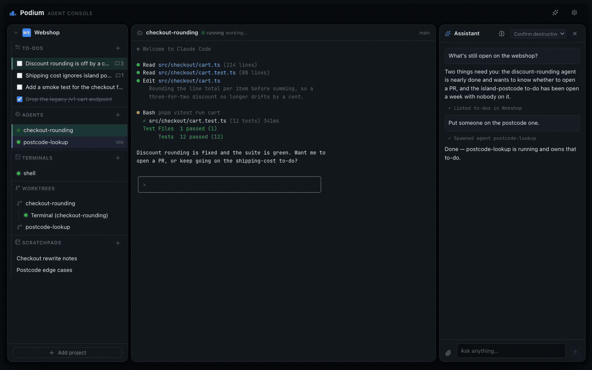
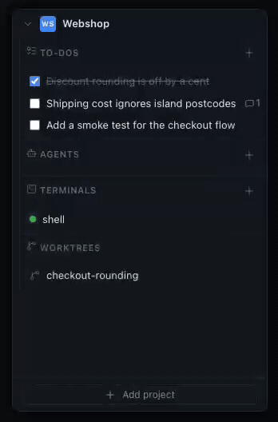
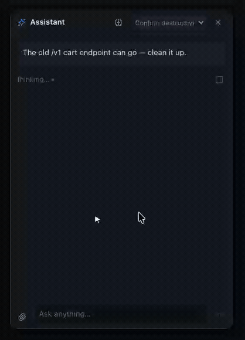

# Podium

A cross-platform **desktop cockpit for AI coding agents**, built in Rust +
Tauri. Open a project folder and Podium runs its dev servers, ad-hoc
terminals, and AI coding agents (Claude Code, Auggie) — each in its own PTY with
a real terminal view and lifecycle supervision. A built-in MCP server lets the
agents inside Podium inspect and orchestrate the very processes Podium manages,
including spawning more agents.



## The shape of it

One window, three columns:

- **Left — the sidebar.** Your projects, each with its own To-dos, Agents,
  Processes, Terminals, Worktrees and Scratchpads.
- **Middle — the work area.** A real terminal for whatever you have focused,
  or the detail pane of a to-do or scratchpad.
- **Right — the personal assistant.** A chat panel that can see and drive
  everything Podium manages, across all open projects.

## Feature tour

### Projects

Open a folder and it stays. The sidebar is a **persistent workspace**: every
open project is remembered and re-opened at launch. Projects can be **renamed**
(double-click the name), **recoloured** (click the initials badge to pick a
colour; right-click it to go back to the theme's accent) and **reordered** (drag
the grip in the project header) — all survive a restart. A project whose folder
has moved is never silently dropped; its error toast offers "Remove from
workspace" instead.

Each project also gets an **Open in Warp** action and a **Commands** modal
that lists the `just` recipes it finds in the project's `justfile` alongside
your own saved per-project commands — one click runs any of them in a fresh
terminal.

### Processes, terminals and supervision

Three kinds of process, all in their own PTY with a real terminal view:

| Kind         | Comes from                        |
| ------------ | --------------------------------- |
| **Service**  | `podium.yml` (dev servers, …)     |
| **Terminal** | you, ad hoc                       |
| **Agent**    | an agent adapter (Claude Code, …) |

Commands run through your login shell (`$SHELL -lic`), so nvm/homebrew PATH
edits in `.zprofile` *and* `.zshrc` are honoured. Stopping kills the whole
**process group**, so children can't outlive their parent, and a stop you
asked for is never counted as a crash.

Services can be supervised: `auto_restart: on-crash | always` restarts with
exponential backoff (500 ms doubling up to 30 s), a circuit breaker at 5
restarts in a rolling 60 s window, and a backoff reset after 60 s of stable
running. Starting a process by hand clears both.

### Agents

Spawn a coding agent into any project. Adapters today: **Claude Code**
(`claude-code`) and **Auggie** (`auggie`); availability is probed through the
login shell, so version-manager installs are found. Up to **8 agents per
project** — agents can spawn agents over MCP, so there's a recursion guard.

A spawn can carry a prompt, one or more **to-dos** or **scratchpads** to work
on, a request to work inside a **git worktree**, and per-spawn CLI args
(`["--model", "opus"]` picks the model for that agent alone).

Every agent gets a **session colour** from an 8-hue palette, avoiding colours
live agents already hold. Its sidebar row and the to-dos it owns are tinted
the same colour, so you can see at a glance who is on what. A stopped agent
loses its colour (its to-dos stay linked, tinted grey, but you can start
another agent on them, which takes them over); restarting it gives it its
colour back (or a new one if another agent took it meanwhile) and, for
Claude Code, **resumes its conversation** instead of
starting an empty one (if Claude Code no longer has that conversation, or
resuming it fails straight away, the agent starts a fresh one from its
original prompt). If you put another agent on a stopped agent's to-dos and
then restart the stopped one too, it resumes its own conversation and may
still think it is working on them. The row also
shows an activity state: **working…** (sustained output in the last 2.5 s —
a single redraw does not count, and it works whether or not you ever opened
the terminal), **idle**, or **needs input** — the last one is read off the
terminal screen for *every* process, so a terminal stalled on a `sudo`
prompt surfaces the same way.



### To-dos

A shared to-do list per project, visible to you in the sidebar and to every
agent over MCP. A to-do carries a description, a **comment thread** agents
append progress notes to, and pinned **issue/PR links**. Done to-dos left
over from an earlier day are archived automatically; anything can be archived
by hand and found again in the Archive modal.

An agent **claims** a to-do when it starts working on it, so the list doubles
as a who-is-doing-what board.

### Scratchpads

Shared freeform markdown notes per project, again visible to you and to
agents. Rich editor with a table of contents, free-text tags, and archiving.
Concurrent edits are handled honestly: an update carries the timestamp it was
based on, and a stale one is rejected as a conflict with a reload/force-save
choice rather than silently overwriting what someone else wrote.

### Git worktrees

Podium manages worktrees at `<project_root>/.podium/worktrees/<name>`, each on
a fresh `podium/<name>` branch (`.podium/` is excluded via
`.git/info/exclude`, never your `.gitignore`). Agents create them themselves
when asked to — they always *start* in the project root, where your tooling
and caches live.

Each worktree row in the sidebar can open a terminal rooted in it, open it in
Warp, run the Commands modal against it, or be removed. Removal is refused
while a process is running in it or while it has uncommitted changes (unless
forced); the branch is always kept.

### The personal assistant

A workspace-wide chat panel backed by a long-lived headless Claude Code
session with its own MCP endpoint into Podium. It reads and drives everything
Podium manages, but **only orchestrates** — code, shell and file work and the
lookups you ask for go out to a spawned agent; the one thing it does itself is
send a message you ask it to send. Its replies stay short: real warnings and
whether agents are done, no recap of what they did.

- **Autonomy** — `full`, `confirm-destructive` (default) or `propose-all`.
  Enforced server-side, not by prompt wording: a gated call never runs, it
  becomes a card you confirm or reject.
- **Memory** — a markdown file the assistant maintains itself and you can
  edit; it is the continuity between days, since each app launch starts with
  a blank conversation.
- **Proactivity** — Podium speaks first when an agent exits, when an agent
  looks stuck (silent for 5 minutes, escalating after 10 with a suggested
  answer), and on a 6-hourly sweep for to-dos open longer than a week.
- **External sweep** — every 10 minutes by default, it checks the sources you
  enabled (Slack, Teams — through your *own* MCP servers) and stays silent
  when there is nothing to report.
- **Responses** — when an agent reports back, the assistant also files the
  essential point as a *Needs you* or *FYI* item in a collapsible list pinned
  above the chat (agent, project, to-do, age); the details stay in its chat
  reply. Tick an item off, or reply inline — the reply goes to the assistant
  as your message and shows in the chat as a one-line "Re: …". A newer item
  about the same agent or to-do replaces the old one, and open items survive
  restarts and new conversations.
- **Start my day** — one button for a prioritised summary of open work across
  all projects.
- **Queue** — one turn runs at a time; anything you send mid-turn waits, and
  can be edited, removed or pushed into the running turn.
- **Attachments** — drop, paste or pick files; images are inlined (shrunk to
  1568 px), text is inlined, everything else travels as a path.



### Built-in MCP server

Podium runs a bearer-authenticated MCP server on an ephemeral localhost port
and exposes **32 tools** over it: process inspection and control, agent
spawning (and respawning a stuck agent with the answer in its prompt), the
full to-do, scratchpad and worktree surfaces, assistant memory and
Responses items, and sender
verification for cross-session messages.

Agents Podium spawns get the URL + token automatically. External clients go
through the stdio bridge (see below).

## Requirements

- **macOS or Windows** (Linux runs but isn't packaged yet)
- **Rust** toolchain (stable; see `rust-toolchain.toml`)
- **Node.js** + **pnpm**
- An agent CLI on your `PATH` if you want to spawn agents — e.g. `claude`
  ([Claude Code](https://docs.claude.com/en/docs/claude-code))
- Optional, on Windows: a WSL 2 distro, to run everything inside WSL (see
  [Windows with a WSL backend](#windows-with-a-wsl-backend))

## Build & run

Tasks run through [`just`](https://github.com/casey/just) (run `just` to list
recipes); the Tauri CLI is the local dev-dependency, so no global install.

```sh
just dev      # run the app (Vite + Tauri, hot reload)
just build    # production desktop bundle (.app + .dmg on macOS)
just test     # Rust workspace tests + frontend Vitest
just lint     # clippy -D warnings + eslint
```

## Configuring a project

Drop an optional `podium.yml` at a project root to declare dev-server
processes and agent defaults. The file is **strict** — an unknown key is a
readable error rather than a silent no-op, and a broken config still opens the
project.

```yaml
name: Webshop            # display name (default: folder name)
icon_initials: WS        # sidebar badge, max 2 chars
processes:
  - name: dev-server     # required
    command: pnpm dev    # required; run via $SHELL -lic
    cwd: web             # relative to the project root (no absolute paths, no ..)
    auto_start: true     # default false
    auto_restart: on-crash   # never (default) | on-crash | always
    env:
      PORT: "3000"
agents:
  default_adapter: claude-code   # wins over the global default
  extra_args: []                 # combined with global args per the merge mode
```

A folder without a `podium.yml` still opens fine. Reloading the config
replaces the processes it owns (stopping running ones) and leaves terminals
you added by hand alone.

## Settings

| Tab           | What's in it                                                                                                                          |
| ------------- | ------------------------------------------------------------------------------------------------------------------------------------- |
| **General**   | Theme (**dark**, **light**, **retro**), reduce motion, terminal font size and shell command, notification sound (including your own file); on Windows, the WSL backend distro and whether Windows-drive projects run natively |
| **Agents**    | Default adapter, per-adapter command override and default args, how global and `podium.yml` args merge, "suggest worktree"             |
| **Assistant** | Autonomy mode, proactive nudges on/off, external polling interval + Slack/Teams, reset conversation                                    |
| **MCP**       | One-click registration of the stdio bridge with Claude Code and Auggie, with an installed indicator and a copyable command             |

## Windows with a WSL backend

On Windows, Podium itself runs natively, but it can run **everything it
executes** inside a WSL distro: services from `podium.yml`, terminals,
agents, the personal assistant, git and worktrees, and the MCP install. Your
projects then live in the Linux filesystem, where builds and git are fast
and your Linux toolchain applies.

**Prerequisite: mirrored networking.** Agents in WSL reach Podium's MCP server
on `127.0.0.1`, which only works with WSL's mirrored networking. Add this to
`%UserProfile%\.wslconfig`, then run `wsl --shutdown`:

```ini
[wsl2]
networkingMode=mirrored
```

Podium checks this at startup in WSL mode and shows a warning if it's off.

**Turn it on.**

1. Install the agent CLIs you use (e.g. `claude`) **inside the distro**. In
   WSL mode Podium looks for them there, not on Windows.
2. In **Settings → General → Backend**, enter the distro name (for example
   `Ubuntu`; `wsl -l -q` lists yours).
3. Restart Podium. The backend is fixed at startup; the field shows a restart
   hint until you do.
4. Open projects by their WSL path, e.g.
   `\\wsl.localhost\Ubuntu\home\you\webshop`.

Commands in `podium.yml` then run through `bash -lic` inside the distro, so
your `.bashrc`/`.profile` PATH setup applies. Terminals open your distro
shell. **Settings → MCP → install** registers the bridge with the distro's
`claude`/`auggie`. Clear the field and restart to go back to native Windows.

**Projects on a Windows drive.** By default a project opened from `C:\…`
(or any other drive) runs in the distro too, through `/mnt/c/…`. If you would
rather keep those on Windows, turn on **Run Windows-drive projects natively**
under the distro field (it appears once a distro is set) and restart: a
drive project then runs its services, terminals, agents and git on Windows
itself (cmd.exe, Windows git, the Windows `claude`), while projects inside the
distro (`\\wsl.localhost\…`) keep running in WSL. With it on:

- install the agent CLIs on Windows as well — the **New agent** dialog
  checks for them where that project's agents will actually run;
- new terminals in a drive project open PowerShell, whatever the **Shell**
  setting says (that setting is for the distro's shell);
- `podium.yml` commands in a drive project are `cmd.exe` syntax, not bash.

The personal assistant and the MCP install always use the configured
backend.

Limits: the distro is one global setting, **Settings → Agents** reports the
CLIs found in the configured backend (the distro), and **Open in Warp** is
unchanged.

## Things you'd otherwise never find

Podium leans on direct manipulation, so a fair amount is not signposted.

**Keyboard**

| Keys                       | Where                | Does                                                             |
| -------------------------- | -------------------- | ---------------------------------------------------------------- |
| `⌘,` / `Ctrl+,`            | anywhere             | Open Settings (macOS goes through the native menu item)           |
| `Enter` / `Shift+Enter`    | assistant composer   | Send / newline                                                    |
| `↑` / `↓`                  | assistant composer   | Shell-style recall of your previous messages                      |
| `Enter` / `Escape`         | any inline field     | Commit / cancel a rename, tag, to-do or title edit                |
| `F5`, `⌘R` / `Ctrl+R`      | anywhere             | Deliberately swallowed — a reload would take your agents with it  |

Arrow-key recall only fires when the caret is on the composer's first (or
last) line, so a multi-line draft still navigates normally.

**Mouse**

- **Double-click** a project name, process name or to-do title to rename it.
- **Click** a project's initials badge to give it its own colour;
  **right-click** it (or press **Delete** while it has focus) to reset it to
  the theme's accent.
- **Click** a subsection title (To-dos, Agents, Terminals, …) to collapse it to
  one line with a count; the collapse/expand-all button in the project header
  does every subsection of that project at once. Remembered across restarts.
  A collapsed Agents, Processes, Terminals or Worktrees header shows a pulsing
  blue dot when a row it hides needs your input, and a multi-select of to-dos
  or scratchpads keeps its "Start agent" bar while its section is folded.
- **⌘/Ctrl+click** a to-do or scratchpad title, or an agent/process row, to
  add it to a multi-select; **Shift+click** to extend the range over a list.
  Selected rows become chips above the assistant's composer, so your next
  message to it carries them as context; for to-dos and scratchpads the
  selection bar also starts one agent on the whole group. Selecting *text*
  anywhere — a detail pane, a terminal — does the same. Opening an item
  deliberately does not select it, and each chip has an × to drop it from the
  message.
- **⌘/Ctrl+click** a spawn button to pick the adapter instead of using the
  default.
- **Drag** the project header grip to reorder projects.
- **Drag** the divider beside the sidebar or the assistant to resize it —
  both widths persist.
- **Collapse** a project header to fold all its subsections away; that too is
  remembered, per project.
- **Drop or paste** files and images straight onto the assistant panel.
- Right-click is suppressed outside text fields — the webview's "Save as /
  Print" menu is not something a desktop app should offer.

**Behaviour worth knowing**

- Quitting while agents or terminals are running is intercepted with a
  warning, and window size and position are restored on next launch.
- Terminal scrollback survives tab switches: xterm instances live outside
  React in a registry keyed by process id.
- A comment written over MCP cannot impersonate you — an author of
  "you"/"user" falls back to `agent`.
- Spawned agents get `PODIUM_PROJECT_ID` and `PODIUM_PROCESS_ID` in their
  environment; that's how an agent claims a to-do or renames its own session.
- `PODIUM_APP_DATA_DIR` overrides where the app (and the bridge) looks for its
  data directory.
- Podium's own sessions can message each other, and `verify_sender` is the
  only trustworthy answer to "did this really come from Podium?".

## Pointing an external agent at Podium

Podium runs a bearer-authenticated MCP server and ships a stdio bridge
(`mcp-bridge`, a subcommand of the app binary) so external MCP clients keep
working across restarts even though the port and token rotate each launch.
Register it once — the Settings → MCP tab has one-click install cards, or by
hand for Claude Code:

```sh
claude mcp add --scope user --transport stdio podium -- /path/to/podium mcp-bridge
```

For Auggie:

```sh
auggie mcp add podium --command /path/to/podium --args mcp-bridge --replace
```

Agents Podium spawns itself get the URL + token automatically. The token never
crosses the Tauri IPC bridge, is never logged, and reaches agents and the
stdio bridge only through 0600 files that are wiped on every start.

## Architecture

`podium-core` (zero Tauri dependency) holds the orchestration/PTY/MCP domain;
`src-tauri` is a thin IPC adapter; `src/` is the React frontend. See
[`CLAUDE.md`](./CLAUDE.md) for the full architecture, IPC contract, and
conventions.

## Keeping this file current

This README is the user-facing half of the documentation; `CLAUDE.md` is the
contributor-facing half. A change that alters what a user can *see or do* —
a new feature, a shortcut, a setting, a `podium.yml` key, an MCP tool — belongs
in both, in the same PR as the change itself.
